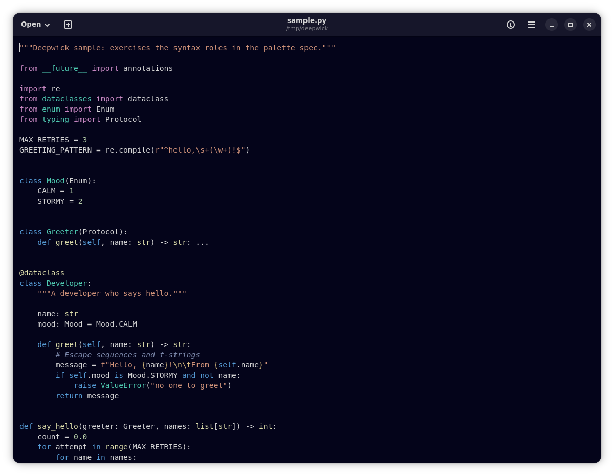

# Deepwick for GtkSourceView

A deep navy style scheme with Visual Studio 2022's syntax colors, for editors
built on GtkSourceView: GNOME Text Editor, gedit, GNOME Builder, Meld, and more.

> Deepwick is an unofficial theme derived from
> [Polywick Blue](https://vscode.polywickstudio.net) by Polywick Studio (MIT).
> Not affiliated with Polywick Studio.



## Install

GtkSourceView 5 (GNOME Text Editor, Builder):

```sh
mkdir -p "${XDG_DATA_HOME:-$HOME/.local/share}/gtksourceview-5/styles"
cp gtksourceview-5/deepwick.xml "${XDG_DATA_HOME:-$HOME/.local/share}/gtksourceview-5/styles/"
```

GtkSourceView 4 (gedit, Meld); the same file also works in the `gtksourceview-3.0`
folder for older apps (untested):

```sh
mkdir -p "${XDG_DATA_HOME:-$HOME/.local/share}/gtksourceview-4/styles"
cp gtksourceview-4/deepwick.xml "${XDG_DATA_HOME:-$HOME/.local/share}/gtksourceview-4/styles/"
```

GNOME Text Editor from Flathub reads its own data folder:

```sh
mkdir -p ~/.var/app/org.gnome.TextEditor/data/gtksourceview-5/styles
cp gtksourceview-5/deepwick.xml ~/.var/app/org.gnome.TextEditor/data/gtksourceview-5/styles/
```

Then pick **Deepwick** in the app's preferences. GNOME Text Editor lists dark
schemes only while it is in dark mode; or select it directly:

```sh
gsettings set org.gnome.TextEditor style-scheme deepwick
```

(For the Flatpak: `flatpak run --command=gsettings org.gnome.TextEditor set org.gnome.TextEditor style-scheme deepwick`.)

## Notes

- GtkSourceView: Python control flow is mostly Blue. Version 4 gives every
  Python keyword one style; version 5 makes `return` and `raise` Magenta but
  keeps `if`, `for` and `and`/`or`/`not`/`is`/`in` Blue. JavaScript/TypeScript
  keywords share one style, so their control flow is Blue too. C keywords are
  split, so C control flow is Magenta.
- Python docstrings are strings (Orange), not comments.
- JavaScript/TypeScript user function and type names are not highlighted.
- A C preprocessor line is one style (bold Muted), so macro names are not
  Magenta.
- There is no interface/enum/struct style, so the Mint role never appears.
- Markdown fenced code is plain Orange.
- GtkSourceView 4 rejects the `<metadata>` block that marks the scheme dark in
  version 5, so there are two files; both are generated by `generate.py`.

Tested with GNOME Text Editor 51.0 (GtkSourceView 5, Flathub) and GtkSourceView 4.8.4.

## License

MIT. See [LICENSE](LICENSE).
